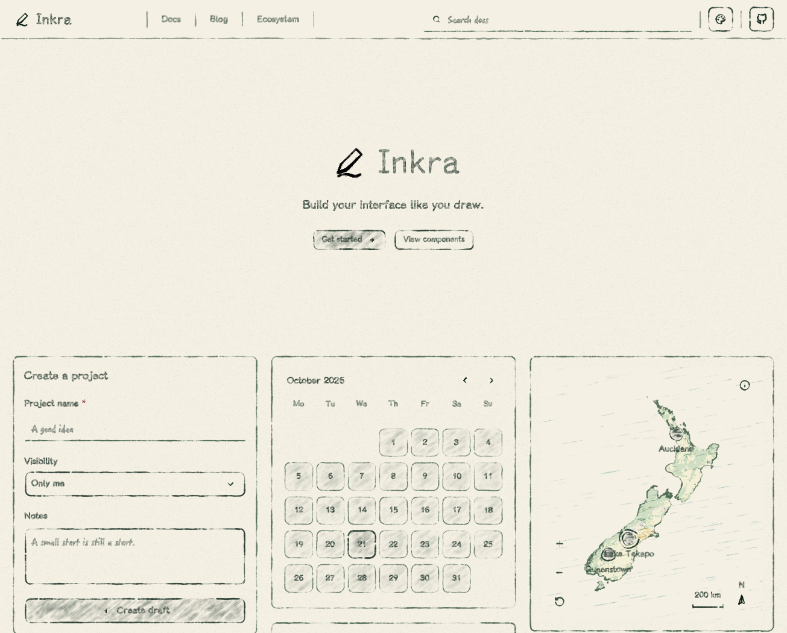

<p align="center">
  <picture>
    <source media="(prefers-color-scheme: dark)" srcset="./assets/inkra-dark.png">
    
  </picture>
</p>

<p align="center">English | <a href="./README.zh-CN.md">简体中文</a></p>

<h1 align="center">Inkra</h1>

<p align="center">Build your interface like you draw.</p>

<p align="center">
  <a href="https://inkrajs.github.io/">Playground</a> ·
  <a href="https://inkrajs.github.io/docs/getting-started">Documentation</a> ·
  <a href="https://www.npmjs.com/package/@inkra/react">npm</a> ·
  <a href="https://github.com/inkrajs/inkra/releases">Releases</a>
</p>

A pencil-styled React component library. Compose familiar controls with paper
texture, soft color and hand-drawn strokes, while real HTML handles input,
selection and keyboard interaction.

## Get Started

Install Inkra in your React project:

```sh
npm install @inkra/react
```

Import the styles once, then use the components:

```tsx
import '@inkra/react/styles.css';
import { Button, Field, Input } from '@inkra/react';

export function NoteForm() {
  return (
    <form onSubmit={event => event.preventDefault()}>
      <Field label="A name for your idea">
        <Input name="title" placeholder="Something worth keeping" clearable />
      </Field>
      <Button type="submit">Save a little inspiration</Button>
    </form>
  );
}
```

Inkra ships ESM, TypeScript declarations and CSS, with React and React DOM as
peer dependencies. React 18 and 19 are the tested release targets. See
[rendering support](./docs/rendering.md) for SSR and framework-specific limits.

## A Little Pencil, Real Components

<p align="center">
  <a href="https://inkrajs.github.io/">
    <picture>
      <source media="(prefers-color-scheme: dark)" srcset="./assets/preview-dark.png">
      
    </picture>
  </a>
</p>

*Real playground screenshots from the development version. The published npm
package and the main branch may contain different features.*

- **Familiar interactions.** Forms, menus, dialogs and navigation use semantic
  HTML and established interaction primitives.
- **A consistent hand.** The same drawing seed produces stable pencil marks;
  decorative canvases do not own layout or intercept input.
- **Room for your palette.** CSS tokens control color, paper, lettering,
  outlines and shading. Light and dark themes share the same components.
- **Examples you can touch.** Adjust properties in the bilingual playground,
  inspect the code and explore combinations such as forms, calendars and maps.

## Find Your Components

The published **0.4.3** package includes these core components:

| Use | Components |
| --- | --- |
| Actions | Button, ButtonLink, ButtonGroup |
| Forms | Field, Input, InputNumber, Textarea, Select, Checkbox, RadioGroup, Switch, Slider |
| Navigation | Tabs, Breadcrumb, DropdownMenu |
| Content and feedback | Card, Table, Accordion, Avatar, Badge, Alert, Progress, Skeleton, Separator |
| Overlays | Popover, Overlay, Tooltip |
| Dates and maps | Calendar, DayAgenda, JourneyMap |
| Drawing | PencilIcon, PencilText, PencilSurface, PencilLine |

**New in 0.2.0:** richer forms and overlays, layout primitives, media
controls (AudioPlayer, Carousel, ImageViewer, ImageCropper), graph and canvas
interactions (NodeGraph, Sortable, PanZoom), data views (Log, Radar, Heatmap,
Sparkline, VirtualList) and circular Progress.

**New in 0.3.0:** exact bigint and decimal-string NumberTicker values, configurable
units and rounding, InputNumber modifier steps and hold repetition, popup motion,
password examples and localized, collapsible playground settings.

**New in 0.4.3:** theme-aligned Markdown, ColorSwatch and gradient editing,
built-in Editable text/select editors, full-viewport image/video viewing, Tabs
overflow controls, independent Toast queues and expanded icon stroke controls.
Rendering and documentation performance are improved, with simpler primary
previews and a nine-icon size/pressure/gap playground. Version 0.4.3 is published
on npm and verified with React 18 and 19.
See [Releases](https://github.com/inkrajs/inkra/releases),
the [changelog](./CHANGELOG.md) and
[package API](./packages/inkra/README.md) for the full scope and known limits.

## Work on Inkra

Use Node.js 22.12+ and npm:

```sh
git clone https://github.com/inkrajs/inkra.git
cd inkra
npm ci
npm run build
npm run check
```

Checks cover the repository, component tests and a separately installed
package's types, SSR and assets. Run `npm run check:installed -- --browser`
for the additional browser hydration checks.

The playground lives in [inkrajs/docs](https://github.com/inkrajs/docs).
To preview local library changes, follow its candidate preparation instructions;
it installs a verified package archive, never a source alias.
Website deployment and npm releases are separate workflows.

## Documentation and Feedback

- [Getting started](https://inkrajs.github.io/docs/getting-started)
- [Component API](./packages/inkra/README.md)
- [Design standards](./docs/design-standard.md)
- [Contributing](./CONTRIBUTING.md)
- [Issues and feature requests](https://github.com/inkrajs/inkra/issues)
- [Release guide](./docs/releasing.md) and [repository organization](./docs/organization-structure.md)

For security reports, follow [SECURITY.md](./SECURITY.md) instead of a public issue.

## License

Inkra is [MIT licensed](./LICENSE). The bundled font uses SIL OFL 1.1;
other bundled assets retain their own terms. See the
[third-party notices](./packages/inkra/THIRD_PARTY_NOTICES.md).
